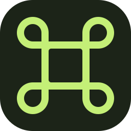

# LittleTec Studio



Configurador em português para o teclado macro **12 teclas + 2 giratórios**.
Uma mesma interface React atende ao **Web** e ao **Desktop Windows**, com serviços
Python compartilhados para comunicação com o teclado.

**[Abrir Web](https://thegodkodda.github.io/littletecstudio/)** ·
**[Baixar Desktop Windows (.exe)](https://github.com/thegodKoDDa/littletecstudio/releases/latest/download/LittleTec-Studio.exe)** ·
**[Downloads e versões](https://github.com/thegodKoDDa/littletecstudio/releases)** ·
**[LittleTec OG preservado](https://github.com/thegodKoDDa/littletec-og)**

[](https://github.com/thegodKoDDa/littletecstudio/actions/workflows/ci.yml)

## Produto de referência e identificação USB

**[Mini Teclado Mecânico Programável — 12 teclas + 2 knobs, RGB e USB Type-C (AliExpress, item 1005006437127027)](https://pt.aliexpress.com/item/1005006437127027.html)**

Esse é o produto de referência utilizado no projeto. O suporte USB é específico
para a variante observada **12+2, variante 0**; semelhança visual ou o mesmo
VID/PID em outro aparelho não garante compatibilidade.

| Característica | Referência do projeto |
| --- | --- |
| Controlador | WCH CH57x |
| USB VID:PID | **`1189:8842`** (`0x1189:0x8842`, `VID_1189&PID_8842`) |
| Interface de configuração | `MI_00`, HID de fornecedor, Usage Page `0xFF00`, Usage `0x01` |
| Relatórios de configuração | 65 bytes, Report ID `0x03` |
| Camadas | Três camadas independentes |
| Teclas | 12 teclas mecânicas, `Tecla 01` a `Tecla 12` |
| Giratórios | Dois knobs; esquerda, clique e direita independentes em cada um |
| Posições configuráveis | 18 por camada, 54 nas três camadas |
| Iluminação | Sete cores nativas: vermelho, laranja, amarelo, verde, ciano, azul e roxo |
| Modos LED | Desligado, estático, respiração, ciclo automático, onda ao pressionar e acender tecla ao pressionar |

No Studio, a entrada ao vivo usa a interface `MI_01` por Windows Raw Input;
a configuração usa HIDAPI na `MI_00`. O OG preserva sua interface Qt, sem o
monitor ao vivo do Studio. LED não tem readback conhecido: prévia e último
comando enviado não representam leitura do estado interno.

## Escolha como usar

| Formato | Como abrir | Recursos |
| --- | --- | --- |
| Desktop Windows x64 | Baixar e abrir `LittleTec-Studio.exe` | Interface completa, ponte USB incluída e entrada ao vivo |
| Web local no Windows/WSL | `Abrir-Web.cmd` ou `npm run dev` | Interface completa com a ponte Python Windows |
| Web online / GitHub Pages | [Abrir no navegador](https://thegodkodda.github.io/littletecstudio/) | Editor, biblioteca local e importar/exportar perfis; sem ponte USB incluída |
| Editor Web portátil | ZIP Web em [Releases](https://github.com/thegodKoDDa/littletecstudio/releases) | Editor local; não inclui a comunicação USB |

No Desktop, o `.exe` de entrada contém o pacote completo. Pode ser aberto de
uma pasta Windows ou do checkout WSL: ele prepara a execução em disco local,
sem exigir instalação de Node.js ou Python. A primeira abertura pode levar mais
tempo. Não abra o executável interno de `release/win-unpacked` diretamente pelo WSL.

## Conexão ao abrir

O Desktop e o Web local tentam conectar e ler o teclado automaticamente ao abrir.
O botão **Conectar teclado / Ler teclado** continua disponível. A conexão
inicial não aplica mapeamento ou iluminação e não substitui um rascunho salvo
ou uma edição em andamento. Sem teclado ou ponte, o editor continua disponível.
Pages e o pacote HTML permanecem editores locais, sem tentativa automática USB.

A entrada portátil reaproveita o pacote preparado no Windows, sem extrair um
ambiente Python a cada abertura. A primeira execução de cada versão prepara o
pacote uma vez. [Medições e detalhes da otimização](docs/OTIMIZACAO_0.4.0.md).

## Funcionalidades

- Três camadas, 12 teclas e dois giratórios com esquerda, clique e direita.
- Catálogo de teclado, modificadores, mídia, mouse, atraso e sequências de até 20 etapas.
- Presets, inversão e cópia dos giratórios; edição contextual e captura pelo teclado.
- Sete cores, seis modos de iluminação e envio por camada ou nas três.
- Perfis JSON v1/v2, biblioteca local, importação/exportação, desfazer/refazer e revisão.
- Leitura/aplicação, cópias brutas com hashes, diagnóstico e preservação de dados opacos.
- Entrada ao vivo Windows, destaques e animações associadas aos comandos identificados.
- Tema claro/escuro e interface responsiva, compartilhada entre Web e Desktop.
- Ícone oficial derivado de `desktop/icon.png` nos executáveis, janela, navegador e interface.

USB validado para **1189:8842, modelo 12+2, variante 0**. Outros modelos do catálogo
são rascunhos, sem suporte USB implícito. LED não tem readback: seleção local e
último envio não representam leitura do estado interno. A aplicação faz cópia,
releitura e tentativa de retorno em falha; o retorno não é garantido se o aparelho
ficar inacessível. Firmware, flash e troca de driver não fazem parte do uso normal.

## Continuidade e LittleTec OG

Este repositório continua o antigo `littletec-web`, preservando seu histórico e
as versões Web anteriores. **LittleTec Studio 0.4.0** reúne a evolução do Web e
o novo Desktop Electron.

O [LittleTec OG](https://github.com/thegodKoDDa/littletec-og) conserva o desktop
Python/Qt **1.1.0**, fontes, distribuição e histórico. Seu desenvolvimento foi
encerrado: novas funcionalidades e correções seguem aqui. Os originais do
fabricante e evidências locais continuam preservados; não são enviados ao GitHub.

Compartilhar código faz as melhorias comuns chegarem aos próximos builds dos
dois formatos. Bibliotecas de perfis não se sincronizam pela internet; use JSON
para transferi-las. Executáveis instalados não têm atualização automática.

## Desenvolver

Requisitos: Node.js 22+, Python Windows x64 para USB/build Windows; Python 3 no
Linux para testes puros. Na raiz:

```sh
npm ci
```

No Windows:

```powershell
python -m venv .venv-windows
.venv-windows\Scripts\python.exe -m pip install -r requirements/windows-desktop.txt
npm run dev
```

No WSL, crie `.venv-windows` com Python **Windows**; o inicializador usa relay
para manter o transporte no Windows. `npm run dev:ui` abre só o editor. Para o
Desktop em desenvolvimento, use `npm run desktop:dev`; no Linux, ele é editor
sem USB. O pacote `.exe` é a execução Windows completa.

## Estrutura

| Caminho | Conteúdo |
| --- | --- |
| `src/` e `public/` | Interface e recursos comuns Web/Desktop |
| `desktop/` | Janela Electron, preload, ponte IPC e entrada portátil |
| `bridge/` | Ponte Python, entrada ao vivo e núcleo em `core/littletec/` |
| `tools/` e `requirements/` | Execução, build, verificação e dependências |
| `tests/` e `bridge/test_*.py` | Testes sem hardware e testes visuais |
| `docs/` | Estado, arquitetura, uso e histórico |
| `release/` | Entregas geradas; publicadas como assets das releases, fora do Git |
| `.local/` | Cópia Web anterior e versões experimentais preservadas, somente locais |
| `.runtime/` | Evidências e dados de execução, somente locais |

## Verificar e gerar entregas

```sh
npm test
python3 -m unittest discover -s bridge -q
npm run typecheck
npx playwright test
npm run desktop:build
npm run test:desktop:ui
npm run web:pack
npm run desktop:pack
```

`desktop:pack` requer Python Windows e gera o executável único, ZIP da distribuição
e SHA-256. `web:pack` gera o editor portátil; `build:pages` gera a publicação online.
Testes físicos são opt-in; testes e build não conectam o teclado automaticamente.

Veja [documentação](docs/README.md), [guia Desktop](docs/DESKTOP.md),
[estado atual](docs/ESTADO_ATUAL.md) e [changelog](CHANGELOG.md).
O pacote Windows não tem assinatura Authenticode nesta versão.

[Licença ISC](LICENSE). HIDAPI, Electron/Chromium e demais bibliotecas mantêm suas
licenças na distribuição. O arquivo original do fabricante permanece no OG local.
