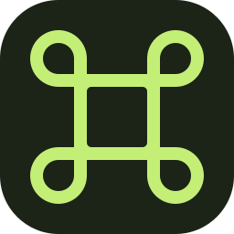

# LittleTec Studio

<div align="center">
  
  <h3>O configurador definitivo e aberto para o teclado macro 12 teclas + 2 giratórios (CH57x / 1189:8842).</h3>
  <p>Disponível nativamente para <strong>Windows Desktop (Portátil x64)</strong> e no <strong>Navegador Web</strong> com suporte multilíngue (Português, English, Español).</p>

  <p>
    <a href="https://thegodkodda.github.io/littletecstudio/"><strong>🌐 Abrir Web App Online</strong></a> ·
    <a href="https://github.com/thegodKoDDa/littletecstudio/releases/latest/download/LittleTec-Studio.exe"><strong>⬇️ Baixar Desktop Windows (.exe)</strong></a> ·
    <a href="https://github.com/thegodKoDDa/littletecstudio/releases"><strong>📦 Releases e Versões</strong></a> ·
    <a href="https://github.com/thegodKoDDa/littletec-og"><strong>🏛️ LittleTec OG (Legado Qt)</strong></a>
  </p>

  <p>
    <a href="https://github.com/thegodKoDDa/littletecstudio/actions/workflows/ci.yml"></a>
    <a href="https://github.com/thegodKoDDa/littletecstudio/releases"></a>
    <a href="LICENSE"></a>
    
    
  </p>
</div>

---

## 🎯 Por que o LittleTec Studio existe?

Os teclados mecânicos compactos de **12 teclas e 2 botões giratórios (knobs)** vendidos no AliExpress, Shopee e Amazon utilizam o microcontrolador **WCH CH57x** (`VID: 1189, PID: 8842`). 

O software original fornecido pelo fabricante é frequentemente:
- Difícil de encontrar ou distribuído através de links desconhecidos e suspeitos (Baidu, Google Drive público);
- Marcado por falsos positivos em antivírus devido a empacotadores genéricos;
- Limitado em opções visuais, sem suporte a múltiplos idiomas e sem campo de testes em tempo real;
- Travado e sem código aberto.

O **LittleTec Studio** resolve isso entregando uma solução **moderna, transparente, de código aberto e segura**, compartilhando a mesma base de interface responsiva e componentes React entre a versão **Desktop (Electron + ponte Python nativa)** e o **Web App** (rodando localmente ou no GitHub Pages).

---

## 🔍 Identificação do Hardware e Compatibilidade

* **Produto de Referência**: [Mini Teclado Mecânico Programável — 12 teclas + 2 knobs, RGB e USB Type-C (AliExpress, item 1005006437127027)](https://pt.aliexpress.com/item/1005006437127027.html)
* **Compatibilidade**: Modelo **12+2, variante 0** (CH57x).

| Especificação | Detalhes do LittleTec Studio |
| :--- | :--- |
| **Controlador** | WCH CH57x |
| **USB VID:PID** | **`1189:8842`** (`0x1189:0x8842`, `VID_1189&PID_8842`) |
| **Interface de Configuração** | `MI_00`, HID Vendor-Defined, Usage Page `0xFF00`, Usage `0x01` |
| **Relatórios de Configuração** | 65 bytes por pacote, Report ID `0x03` |
| **Interface de Leitura ao Vivo** | `MI_01` (Windows Raw Input / eventos de tecla, multimídia e mouse) |
| **Layout Físico** | 12 switches mecânicos + 2 knobs rotativos (giro horário, anti-horário e clique) |
| **Capacidade** | 3 camadas independentes (18 ações por camada = 54 ações configuráveis) |
| **Iluminação RGB** | 7 cores nativas (Vermelho, Laranja, Amarelo, Verde, Ciano, Azul, Roxo) e 6 modos LED |

---

## ✨ Principais Funcionalidades

### 🌐 1. Multilíngue Completo (i18n)
Alternância dinâmica em um clique entre **Português (PT-BR)**, **Inglês (EN)** e **Espanhol (ES)** no topo da aplicação, com persistência automática da preferência do usuário.

### ⌨️ 2. Campo de Teste de Teclas & Diagnóstico
Área dedicada para validar suas configurações em tempo real:
- Detecção instantânea de teclas convencionais e atalhos combinados;
- Suporte a teclas estendidas de automação (**F13 a F24**);
- Monitor visual de modificadores físicos (**Ctrl, Shift, Alt, Win/Cmd**);
- Caixa de digitação para teste de sequências contínuas de macros de texto;
- Histórico detalhado de eventos registrados com carimbo de data/hora e códigos físicos.

### ⏺️ 3. Gravador Interativo de Macros
Grave sequências diretamente pelo seu teclado com cálculo automático de atrasos (*delays*) e atribua imediatamente a qualquer tecla ou direção de knob.

### 🎨 4. Modelos Prontos por Aplicativo (Presets)
Configurações pré-definidas de 1 clique otimizadas para o layout 12+2:
- **Adobe Photoshop**: Zoom, pincel, desfazer, camadas, exportação rápida.
- **Adobe Premiere Pro**: Corte (*cut*), ripple delete, navegação frame a frame no knob, play/pause.
- **Blender 3D**: Visões ortográficas, modos vértice/aresta/face, render, extrusão.
- **OBS Studio & Stream**: Troca de cenas, mutar microfone, áudio do desktop, início/fim de transmissão.
- **VS Code**: Comentar linhas, duplicar linhas, busca global, terminal integrado.
- **Discord**: Mudo de voz, ensurdecer (*deafen*), empurrar para falar (*PTT*).

### 🚀 5. Portabilidade e Abertura Instantânea
- **Zero Instalação**: O executável `LittleTec-Studio.exe` é 100% portátil. Basta baixar e dar duplo clique.
- **Cache Inteligente**: O launcher em C# gerencia a extração em cache apenas na primeira execução da versão. As aberturas seguintes ocorrem em milissegundos.
- **Transição Fácil**: Na versão Web você pode baixar a versão Desktop com um clique; na versão Desktop você pode abrir a versão Web no seu navegador padrão.

---

## 💻 Como Utilizar

| Formato | Como abrir | Recursos |
| :--- | :--- | :--- |
| **Desktop Windows x64** *(Recomendado)* | Baixar e executar [`LittleTec-Studio.exe`](https://github.com/thegodKoDDa/littletecstudio/releases/latest/download/LittleTec-Studio.exe) | Comunicação USB direta, leitura e gravação no aparelho, monitor de giro ao vivo. |
| **Web Online (GitHub Pages)** | Acessar [`thegodkodda.github.io/littletecstudio`](https://thegodkodda.github.io/littletecstudio/) | Edição completa no navegador, importação/exportação JSON, presets e playground. |
| **Web Local com USB** | Executar `Abrir-Web.cmd` ou `npm run dev` no Windows/WSL | Executa a interface Web local conectada à ponte Python USB do Windows. |
| **Editor Web Portátil (Offline)** | Baixar o pacote ZIP Web em [Releases](https://github.com/thegodKoDDa/littletecstudio/releases) | Execute o arquivo `index.html` em qualquer máquina sem servidor. |

---

## 🛠️ Desenvolvimento e Contribuição

### Requisitos
- **Node.js**: versão 22 ou superior
- **Python**: versão 3.10+ (Windows x64 para testes com hardware; Linux para suíte de testes unitários)

### Configuração Inicial
```sh
# Clone o repositório
git clone https://github.com/thegodKoDDa/littletecstudio.git
cd littletecstudio

# Instale as dependências
npm ci
```

### Ambiente Windows (com ponte USB)
```powershell
python -m venv .venv-windows
.venv-windows\Scripts\python.exe -m pip install -r requirements/windows-desktop.txt
npm run dev
```

### Comandos Úteis
```sh
npm test                 # Executa os 22 testes unitários do Studio e i18n
npm run typecheck        # Checagem estrita de tipos TypeScript
npx playwright test      # Testes de ponta a ponta (E2E) no navegador
npm run sync             # Sincroniza, compila Desktop/Web e recria os binários
npm run sync:watch       # Modo observador com sincronização contínua em tempo real
```

---

## 📚 Documentação Adicional

- [Guia do Aplicativo Desktop](docs/DESKTOP.md)
- [Estado Atual e Arquitetura](docs/ESTADO_ATUAL.md)
- [Detalhes de Otimização e Abertura](docs/OTIMIZACAO_0.4.0.md)
- [Histórico de Versões (Changelog)](CHANGELOG.md)

---

## 📄 Licença

Distribuído sob a licença [ISC](LICENSE). O arquivo de software original do fabricante permanece preservado no [repositório legado](https://github.com/thegodKoDDa/littletec-og).
